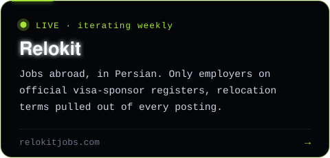
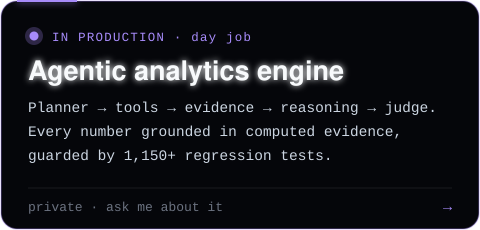
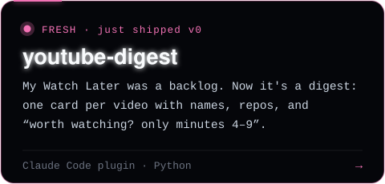
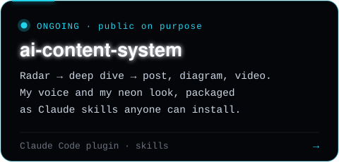
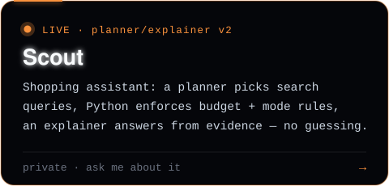
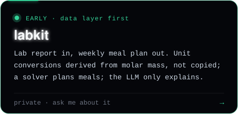
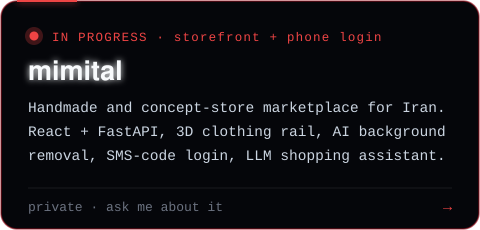
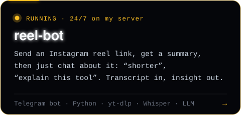

<p align="center">
  
</p>

<p align="center">
  <a href="https://linkedin.com/in/pegahdavari"></a>
  <a href="https://relokitjobs.com"></a>
  <a href="https://github.com/callipegah/ai-content-system"></a>
  
</p>

```yaml
name:        Pegah Davari
based_in:    Tehran 🇮🇷  →  wherever the next good problem is
day_job:     building a production LLM analytics agent @ Snapp
side_quest:  Relokit, jobs abroad with visa sponsorship, in Persian
superpower:  doing something twice by hand, then turning it into a tool
rule_no_1:   if it can be deterministic, don't ask an LLM to do it
fuel:        curiosity + a dangerously long Watch Later list
```

## 🛠️ Now building

<p align="center">
  <a href="https://relokitjobs.com"></a>
  <a href="#-how-i-build-agents"></a>
  <a href="https://github.com/callipegah/youtube-digest"></a>
  <a href="https://github.com/callipegah/ai-content-system"></a>
  <a href="https://github.com/callipegah/scout"></a>
  
  
  <a href="https://github.com/callipegah/reel-bot"></a>
</p>

## 🧠 How I build agents

```text
question --> planner --> tools --> evidence pack --> reasoning LLM --> judge --> answer
                |                        |                               |
                |_____ deterministic ____|      every claim checked here ^
```

- **The model is rarely the bug.** The harness around it (context, tools, checks) usually is.
- **Numbers come from code, words come from the model.** Guardrails cross-check every figure an LLM writes against the evidence and fix what doesn't match.
- **Tests or it didn't happen.** 1,150+ regression tests stand between a prompt change and production.
- **Company claims stay labeled as company claims** until someone else measures them.

## 📦 Shipped & tinkering

| | Project | What it is |
| --- | --- | --- |
| 📈 | [**prometheus-grafana-observability-demo**](https://github.com/callipegah/prometheus-grafana-observability-demo) | A Go service exposing all four Prometheus metric types, visualized in Grafana. One `docker compose up`. |
| 📲 | [**reel-bot**](https://github.com/callipegah/reel-bot) *(running 24/7, private to me)* | Telegram bot: send an Instagram reel link, get a summary, then chat about it ("shorter", "explain this tool"). yt-dlp + Whisper + an LLM, locked to one user ID, no Instagram login. |
| 🎬 | [**youtube-digest**](https://github.com/callipegah/youtube-digest) | `/plugin marketplace add callipegah/youtube-digest` and your Watch Later becomes a reading list. |
| ✨ | [**ai-content-system**](https://github.com/callipegah/ai-content-system) | `/plugin marketplace add callipegah/ai-content-system`: Radar, deep dives, Lightboard visuals, narrated videos. |
| 🛍️ | [**scout**](https://github.com/callipegah/scout) *(private)* | Shopping assistant: a planner picks search queries, Python enforces budget/mode rules, an explainer writes the answer from evidence only — never an invented price or link. |
| 🧪 | **labkit** *(private)* | Lab report in, weekly meal plan out. Unit conversions are derived from molar mass and tested against published factors; extraction is a strict JSON contract; meals come from a constraint solver, not free generation. |
| 🛍️ | **mimital** *(private)* | Marketplace for handmade and concept-store goods in Persian. React + FastAPI + Postgres; clothing hangs on a 3D rail that turns toward you on hover, product photos get AI background removal, login is a phone number plus an SMS code, and an LLM assistant recommends from the real catalog. |

## 🧰 Toolbox

<p align="center">
  
</p>
<p align="center">
  <sub>+ ClickHouse · NATS · OpenShift · LLM agents · evals · Claude Code skills &amp; plugins</sub>
</p>

---

<p align="center">
  <b>Always curious, always shipping something small.</b><br>
  <sub>همیشه کنجکاو، همیشه در حال ساختن یه چیز کوچیک ✦</sub>
</p>
